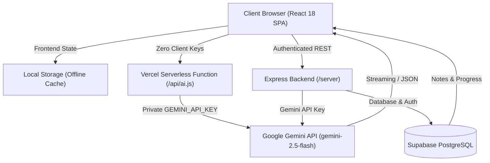

# PrepMind AI 🧠

[](https://opensource.org/licenses/MIT)
[](https://react.dev/)
[](https://www.typescriptlang.org/)
[](https://vitejs.dev/)
[](https://tailwindcss.com/)
[](https://nodejs.org/)
[](https://expressjs.com/)
[](https://ai.google.dev/)
[](https://supabase.com/)
[](https://prep-weblearning.vercel.app/)

> **An intelligent, resilient AI-powered exam preparation and personalized learning platform.**  
> PrepMind AI delivers adaptive practice questions, real-time interactive AI tutoring, structured concept breakdowns, syllabus navigation, and progress analytics across exams like CAT, GATE, UPSC, JEE, and more.

---

## 🔗 Quick Links

- **Live Production App**: [https://prep-weblearning.vercel.app/](https://prep-weblearning.vercel.app/)
- **GitHub Repository**: [https://github.com/sahaya-savari/PrepMind](https://github.com/sahaya-savari/PrepMind)

---

## 🌟 Key Features

* **🎯 Instant Exam Onboarding & Dashboard**: Select from predefined competitive exams (CAT, GATE, UPSC, JEE, NEET) or enter custom exams. Automatically prepares customized syllabus paths, strategy recommendations, and study roadmaps.
* **⚡ Smart MCQ Practice Engine**: Generates topic-wise questions with customizable difficulty levels (`Easy`, `Medium`, `Hard`). Provides immediate scoring, step-by-step solutions, and trick explanations.
* **🤖 Socratic AI Study Tutor (Chat)**: Interactive conversational assistant tailored to the active exam syllabus. Guides students through complex problem-solving rather than just providing static answers.
* **💡 Concept Breakdown & Deep Dives**: Multi-level explanations dissecting core formulas, underlying theory, common traps, and mental shortcuts.
* **📚 Notes & Knowledge Retrieval (RAG-lite)**: Upload or paste study notes to query contextual answers powered by recent notes context in Supabase.
* **📊 Analytics & Mastery Tracking**: Visualizes question accuracy, total attempts, weak areas, and trends with persistent local and cloud storage.
* **🛡️ Offline & Degraded Fallback Mode**: Zero-lockout design—if external API quotas or Supabase credentials are unavailable, the platform automatically falls back to deterministic synthetic generators and offline `localStorage` storage.
* **🎙️ Voice & Audio Synthesis (Companion App)**: Speech synthesis and speech recognition integration via the Web Speech API.

---

## 🛠️ Tech Stack

### Frontend
| Component | Technology | Description |
| :--- | :--- | :--- |
| **Primary App (`/app`)** | **React 18** + **TypeScript** | Modern Single Page Application (SPA) deployed to production |
| **Bundler & Tooling** | **Vite 5** | Lightning-fast HMR and optimized production bundles |
| **Styling** | **Tailwind CSS 3.4** | Modern, responsive dark-mode and glassmorphic user interface |
| **Icons & Animations** | **Lucide React** + **Framer Motion** | Polished micro-interactions and iconography |
| **State & Navigation** | **React Context API** | Modular state for user authentication, exams, and sessions |
| **Companion App (`/`)** | **Vanilla HTML5 / CSS3 / ES6+** | Lightweight, framework-free alternative with Web Speech API |

### Backend & Cloud Services
| Component | Technology | Description |
| :--- | :--- | :--- |
| **API Server (`/server`)** | **Node.js** + **Express 4** | Protected REST API with Bearer token authentication and rate limiting |
| **Serverless Proxy (`/api`)**| **Vercel Serverless Functions** | Secure zero-leakage proxy forwarding requests to Gemini API |
| **AI / LLM Engine** | **Google Gemini API** (`gemini-2.5-flash` / `1.5-flash`) | Contextual reasoning, MCQ generation, and study tutoring |
| **Database & Auth** | **Supabase (PostgreSQL)** | Persistent storage for interviews, notes, and user progress with RLS |
| **Deployment & Hosting**| **Vercel** | CI/CD deployment with edge CDN caching |

---

## 📐 System Architecture

PrepMind AI implements a dual-tier client architecture with secure backend orchestration:



1. **Security-First AI Communication**: Frontend clients never hold raw LLM API keys. All queries route through serverless proxies or Express middleware.
2. **Resilient Failure Handling**: If external API quotas are hit or credentials are not configured, automatic fallbacks generate mock exam structures and save results locally without disrupting the user experience.

---

## 📁 Repository Structure

```
PrepMind/
├── app/                        # Primary React + TypeScript production application
│   ├── src/
│   │   ├── components/         # Reusable UI components (Navbar, Sidebar, Modals)
│   │   ├── context/            # ExamContext, AuthContext
│   │   ├── pages/              # Home, Practice, Chat, Learn, Progress, Notes
│   │   ├── lib/                # Supabase client initialization
│   │   ├── api.ts              # Centralized backend & Supabase integration
│   │   ├── storage.ts          # LocalStorage caching & fallback engine
│   │   ├── App.tsx             # Root application and route controller
│   │   └── main.tsx            # Application entrypoint
│   ├── package.json            # Frontend dependencies
│   ├── vite.config.ts          # Vite build configuration
│   └── tailwind.config.js      # Tailwind CSS design system tokens
│
├── server/                     # Express.js REST API backend
│   ├── server.js               # Express application, routes, and rate-limiting
│   ├── db.js                   # Supabase connection setup
│   ├── package.json            # Server dependencies
│   └── .env.example            # Backend environment variables template
│
├── api/                        # Vercel Serverless Functions
│   └── ai.js                   # Secure proxy for Google Gemini API
│
├── test/                       # Automated test suites
│   ├── api-test.mjs            # AI provider orchestration & validation tests
│   └── local-dev-api.mjs       # Local developer API mock harness
│
├── docs/                       # Production readiness & QA specifications
│   ├── PRODUCTION_READINESS_PRD.md
│   └── PRODUCTION_READINESS_CHECKLIST.md
│
├── js/                         # Original Vanilla JS modules (Companion App)
│   ├── app.js                  # Core controller
│   ├── api.js                  # Client API fetchers
│   ├── practice.js             # MCQ execution logic
│   ├── voice.js                # Web Speech API speech recognition and synthesis
│   └── state.js                # In-memory reactive state manager
│
├── css/                        # Custom CSS stylesheets (Companion App)
├── index.html                  # Companion Vanilla JS app entry point
├── supabase_schema.sql         # PostgreSQL schema (interviews, questions, results) with RLS
├── package.json                # Root package configuration
└── README.md                   # Project documentation
```

---

## 🗄️ Database Schema

The database is built on **PostgreSQL (Supabase)** with Row-Level Security (RLS) enabled. See [`supabase_schema.sql`](file:///d:/PrepMind/supabase_schema.sql) for the complete schema:

```sql
create extension if not exists "pgcrypto";

-- Core interviews / session management
create table if not exists public.interviews (
  id bigint generated by default as identity primary key,
  title text not null,
  role text default 'General',
  user_id uuid references auth.users(id) on delete set null,
  created_at timestamptz default now()
);

-- Practice questions associated with interviews
create table if not exists public.questions (
  id bigint generated by default as identity primary key,
  interview_id bigint references public.interviews(id) on delete cascade,
  question text not null,
  options jsonb not null default '[]'::jsonb,
  correct_answer text,
  explanation text,
  created_at timestamptz default now()
);

-- Evaluated drill results and feedback
create table if not exists public.results (
  id bigint generated by default as identity primary key,
  interview_id bigint references public.interviews(id) on delete cascade,
  user_id uuid references auth.users(id) on delete set null,
  score numeric not null default 0,
  feedback text default '',
  created_at timestamptz default now()
);
```

---

## 🔌 API Endpoints (Express Server)

| Method | Endpoint | Auth Required | Description |
| :--- | :--- | :---: | :--- |
| `GET` | `/api/health` | No | Server uptime & Supabase connectivity status |
| `POST` | `/api/generate` | Bearer Token | Generates topic-specific MCQs with Gemini |
| `POST` | `/api/evaluate` | Bearer Token | Evaluates student answer arrays and returns scores |
| `POST` | `/api/ask` | Bearer Token | Direct LLM conversational query |
| `POST` | `/api/store` | Bearer Token | Stores user notes into Supabase |
| `POST` | `/api/query-context` | Bearer Token | RAG-lite query utilizing stored notes as context |

---

## 🚀 Getting Started

### Prerequisites
* **Node.js**: v18.0.0 or higher
* **npm**: v9.0.0 or higher
* *(Optional)* A [Google AI Studio Gemini API Key](https://aistudio.google.com/)
* *(Optional)* A [Supabase Project](https://supabase.com/)

---

### 1. Clone the Repository

```bash
git clone https://github.com/sahaya-savari/PrepMind.git
cd PrepMind
```

---

### 2. Run the React Production App (`/app`)

```bash
cd app
npm install
npm run dev
```
Open [http://localhost:5173](http://localhost:5173) in your browser.

To configure environment variables for the React app, create `app/.env`:
```env
VITE_API_URL=http://localhost:5000
VITE_API_TOKEN=your_backend_secret_token
VITE_SUPABASE_URL=https://your-project.supabase.co
VITE_SUPABASE_KEY=your_supabase_anon_key
```

---

### 3. Run the Backend Server (`/server`)

```bash
cd ../server
npm install
npm run dev
```
The server will start on [http://localhost:5000](http://localhost:5000).

Create `server/.env`:
```env
PORT=5000
API_TOKEN=your_backend_secret_token
GEMINI_API_KEY=your_google_gemini_api_key
SUPABASE_URL=https://your-project.supabase.co
SUPABASE_KEY=your_supabase_service_role_or_anon_key
```

---

### 4. (Optional) Run the Vanilla JS Companion App

From the project root:
```bash
npx serve .
```
Open [http://localhost:3000](http://localhost:3000) to view the lightweight Vanilla JS interface.

---

## ☁️ Deployment

### Deploying to Vercel

1. Push your repository to GitHub.
2. Import the project into your **Vercel Dashboard**.
3. Set the **Root Directory** to `app` (for the React application) or deploy the root repository.
4. Add the following **Environment Variables** in Vercel Project Settings:
   - `GEMINI_API_KEY`: Your Google Gemini API key.
   - `VITE_SUPABASE_URL`: (Optional) Your Supabase URL.
   - `VITE_SUPABASE_KEY`: (Optional) Your Supabase Anon Key.
5. Deploy! Vercel will automatically provision the application and edge endpoints.

---

## 📄 License

This project is licensed under the **MIT License** — see the [LICENSE](LICENSE) file for details.
