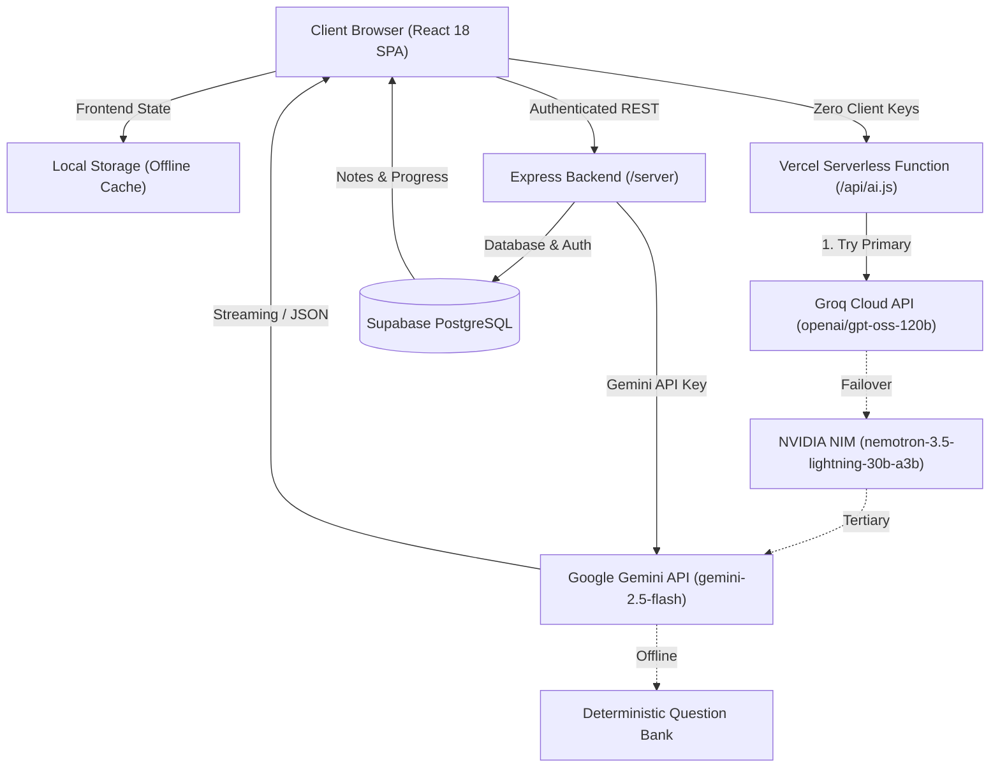

<div align="center">

# PrepMind AI 🧠

**An intelligent, resilient AI-powered exam preparation and personalized learning platform.**

Adaptive practice questions · Socratic AI tutoring · Concept deep dives · Notes retrieval · Progress analytics
for CAT, GATE, UPSC, JEE, NEET and custom exams.

[](https://prep-weblearning.vercel.app/)
[](LICENSE)
[](https://github.com/sahaya-savari/PrepMind)
[](CONTRIBUTING.md)

[](https://react.dev/)
[](https://www.typescriptlang.org/)
[](https://vitejs.dev/)
[](https://tailwindcss.com/)
[](https://nodejs.org/)
[](https://expressjs.com/)
[](https://ai.google.dev/)
[](https://supabase.com/)

[Live App](https://prep-weblearning.vercel.app/) · [Architecture](docs/ARCHITECTURE.md) · [API Reference](docs/API_REFERENCE.md) · [Contributing](CONTRIBUTING.md) · [Changelog](CHANGELOG.md) · [Security](SECURITY.md)

</div>

---

## Table of Contents

- [Overview](#overview)
- [Core Principles](#core-principles)
- [Key Features](#key-features)
- [How It Works](#how-it-works)
- [Tech Stack](#tech-stack)
- [System Architecture](#system-architecture)
- [Repository Structure](#repository-structure)
- [Database Schema](#database-schema)
- [API Endpoints](#api-endpoints)
- [Getting Started](#getting-started)
- [Running Without API Keys](#running-without-api-keys)
- [Deployment](#deployment)
- [Security](#security)
- [Roadmap](#roadmap)
- [Contributing](#contributing)
- [Acknowledgements](#acknowledgements)
- [License](#license)

---

## Overview

PrepMind AI helps students prepare for competitive exams with practice questions, an AI tutor, structured concept breakdowns, syllabus navigation and progress tracking, all in one platform.

It is built to **keep working when things go wrong**: if AI quotas run out or database credentials are missing, the app falls back to built-in question generators and local storage instead of locking the student out.

> [!NOTE]
> AI-generated questions and explanations can contain mistakes. Always verify important facts and formulas against official study material.

## Core Principles

| | Principle |
|---|---|
| 🛡️ | **Resilient:** automatic fallback to offline generators and local storage |
| 🔐 | **Secure by design:** frontend clients never hold raw LLM API keys |
| 🎯 | **Learning-first:** the tutor guides students through problems instead of just giving answers |
| 🔓 | **Open source:** MIT licensed, and contributions are welcome |

---

## Key Features

| | Feature | Description |
|---|---|---|
| 🎯 | **Instant Exam Onboarding & Dashboard** | Select from predefined competitive exams (CAT, GATE, UPSC, JEE, NEET) or enter custom exams. Automatically prepares customized syllabus paths, strategy recommendations, and study roadmaps. |
| ⚡ | **Smart MCQ Practice Engine** | Generates topic-wise questions with customizable difficulty levels (`Easy`, `Medium`, `Hard`). Provides immediate scoring, step-by-step solutions, and trick explanations. |
| 🤖 | **Socratic AI Study Tutor (Chat)** | Interactive conversational assistant tailored to the active exam syllabus. Guides students through complex problem-solving rather than just providing static answers. |
| 💡 | **Concept Breakdown & Deep Dives** | Multi-level explanations dissecting core formulas, underlying theory, common traps, and mental shortcuts. |
| 📚 | **Notes & Knowledge Retrieval (RAG-lite)** | Upload or paste study notes to query contextual answers powered by recent notes context in Supabase. |
| 📊 | **Analytics & Mastery Tracking** | Visualizes question accuracy, total attempts, weak areas, and trends with persistent local and cloud storage. |
| 🛡️ | **Offline & Degraded Fallback Mode** | Zero-lockout design: if external API quotas or Supabase credentials are unavailable, the platform automatically falls back to deterministic synthetic generators and offline `localStorage` storage. |
| 🎙️ | **Voice & Audio Synthesis (Companion App)** | Speech synthesis and speech recognition integration via the Web Speech API. |

---

## How It Works

1. **Choose an exam:** pick CAT, GATE, UPSC, JEE, NEET or enter a custom exam.
2. **Get your roadmap:** syllabus paths, strategy recommendations and a study plan are prepared for you.
3. **Practice:** generate topic-wise MCQs at your chosen difficulty and get instant scoring with solutions.
4. **Ask the tutor:** chat with the Socratic AI tutor tuned to your exam's syllabus.
5. **Use your notes:** upload or paste notes and ask questions against them.
6. **Track progress:** review accuracy, attempts, weak areas and trends.

---

## Tech Stack

### Frontend

| Component | Technology | Description |
| :--- | :--- | :--- |
| **Primary App (`/app`)** | **React 18** + **TypeScript** | Modern Single Page Application (SPA) deployed to production |
| **Bundler & Tooling** | **Vite 5** | Lightning-fast HMR, SWC compiler, and PWA service worker generation |
| **Styling** | **Tailwind CSS 3.4** | Terminal-Dark / Midnight design tokens with smooth transitions |
| **Icons & Animations** | **Lucide React** + **Framer Motion** | Polished micro-interactions, responsive mobile dock, and iconography |
| **State & Navigation** | **React Context API** | Modular state for user authentication, exams, and sessions |
| **Companion App (`/`)** | **Vanilla HTML5 / CSS3 / ES6+** | Lightweight, framework-free alternative with Web Speech API |

### Backend & Cloud Services

| Component | Technology | Description |
| :--- | :--- | :--- |
| **API Server (`/server`)** | **Node.js** + **Express 4** | Protected REST API with Bearer token authentication and rate limiting |
| **Serverless Proxy (`/api`)**| **Vercel Serverless Functions** | Dual-discovery proxy forwarding requests securely to Groq, NVIDIA, or Gemini |
| **AI / LLM Providers** | **Groq**, **NVIDIA NIM**, **Gemini** | High-performance cascade for reasoning, MCQ generation, and study tutoring |
| **Database & Auth** | **Supabase (PostgreSQL)** | Persistent storage for interviews, notes, and user progress with RLS |
| **Deployment & Hosting**| **Vercel** | CI/CD edge deployment with SPA rewrite precedence |

---

## System Architecture

PrepMind AI implements a dual-tier client architecture with secure backend orchestration:



1. **Security-First AI Communication**: Frontend clients never hold raw LLM API keys. All queries route through serverless proxies or Express middleware.
2. **Resilient Failure Handling**: If external API quotas are hit or credentials are not configured, automatic fallbacks generate mock exam structures and save results locally without disrupting the user experience.

> For in-depth architecture specifications and timeout policies, see [`docs/ARCHITECTURE.md`](docs/ARCHITECTURE.md).

---

## Repository Structure

```
PrepMind/
├── app/                        # Primary React + TypeScript production application
│   ├── api/
│   │   └── ai.js               # Serverless proxy discovered when Vercel root is app/
│   ├── public/                 # Static assets, sitemap.xml, robots.txt, og-image.png
│   ├── src/
│   │   ├── components/         # Layout, UI tokens, React Bits, and shared components
│   │   ├── context/            # ExamContext, AuthContext, ThemeContext
│   │   ├── data/               # Deterministic fallback question bank
│   │   ├── hooks/              # useAuth and custom application hooks
│   │   ├── lib/                # Supabase client initialization & Tailwind cn utils
│   │   ├── pages/              # Home, Practice, Chat, Notebook, StudyMaterials, Progress, Profile
│   │   ├── api.ts              # Protected centralized API & database integration layer
│   │   ├── config.ts           # Runtime environment & feature flag constants
│   │   ├── storage.ts          # LocalStorage caching & fallback engine
│   │   ├── App.tsx             # Root application and route controller
│   │   ├── main.tsx            # Application entrypoint
│   │   └── index.css           # Design tokens, midnight palette, typography
│   ├── package.json            # Frontend dependencies & build scripts
│   ├── vite.config.ts          # Vite build configuration (SWC + PWA)
│   ├── vercel.json             # App-level SPA routing & serverless rewrites
│   └── tailwind.config.js      # Tailwind CSS design system tokens
│
├── server/                     # Express.js REST API backend
│   ├── routes/                 # Modular API routes (chat, exam, notes, progress)
│   ├── services/               # Backend business logic (examService, memoryService, ragService)
│   ├── server.js               # Express application, routes, and rate-limiting
│   ├── db.js                   # Supabase connection setup
│   ├── supabase_schema.sql     # PostgreSQL database schema with RLS
│   ├── package.json            # Server dependencies
│   └── .env.example            # Backend environment variables template
│
├── api/                        # Vercel Serverless Functions
│   ├── ai.js                   # Secure proxy discovered when Vercel root is repository root
│   └── rag.js                  # Document processing, chunking & vector embedding service
│
├── test/                       # Automated test suites
│   ├── api-test.mjs            # AI provider orchestration & validation tests
│   ├── byok-test.mjs           # BYOK header & provider preference verification
│   ├── rag-test.mjs            # RAG chunking, vector embeddings, & user isolation tests
│   ├── upload-regression-test.mjs # Upload query builder & Gemini embedding regression tests
│   └── local-dev-api.mjs       # Local developer API mock harness
│
├── docs/                       # Production readiness & QA specifications
│   ├── ARCHITECTURE.md         # In-depth system architecture & data flow
│   ├── API_REFERENCE.md        # Complete endpoint & action payload documentation
│   ├── PRODUCTION_UPGRADE_PLAN.md # 10-phase upgrade plan
│   ├── PRODUCTION_READINESS_PRD.md # Production readiness PRD and audit findings
│   └── PRODUCTION_READINESS_CHECKLIST.md # Quality and security audit checklist
│
├── js/                         # Companion Vanilla JS modules
│   ├── api.js                  # Client API fetchers
│   ├── state.js                # In-memory reactive state manager
│   └── ui.js                   # UI controller and DOM interactions
│
├── css/                        # Custom CSS stylesheets (Companion App)
├── index.html                  # Companion Vanilla JS app entry point
├── supabase_schema.sql         # PostgreSQL schema (interviews, questions, results) with RLS
├── vercel.json                 # Root Vercel SPA routing & serverless rewrites
├── sitemap.xml                 # Search engine canonical XML sitemap
├── robots.txt                  # Web crawler access configuration
├── og-image.png                # Social preview image (1200x630)
├── package.json                # Root package configuration with unified dev/test scripts
├── CONTRIBUTING.md             # Contributor guidelines and workflow
├── CODE_OF_CONDUCT.md         # Contributor Covenant v2.1 code of conduct
├── SECURITY.md                 # Vulnerability disclosure policy
├── SUPPORT.md                  # Support channels and issue templates
├── CHANGELOG.md                # Version history and release notes
├── LICENSE                     # MIT License
└── README.md                   # Project documentation
```

---

## Database Schema

The database is built on **PostgreSQL (Supabase)** with Row-Level Security (RLS) enabled. See [`supabase_schema.sql`](supabase_schema.sql) for the complete schema:

```sql
create extension if not exists "pgcrypto";

-- Core interviews / session management
create table if not exists public.interviews (
  id bigint generated by default as identity primary key,
  title text not null,
  role text default 'General',
  user_id uuid references auth.users(id) on delete set null,
  created_at timestamptz default now()
);

-- Practice questions associated with interviews
create table if not exists public.questions (
  id bigint generated by default as identity primary key,
  interview_id bigint references public.interviews(id) on delete cascade,
  question text not null,
  options jsonb not null default '[]'::jsonb,
  correct_answer text,
  explanation text,
  created_at timestamptz default now()
);

-- Evaluated drill results and feedback
create table if not exists public.results (
  id bigint generated by default as identity primary key,
  interview_id bigint references public.interviews(id) on delete cascade,
  user_id uuid references auth.users(id) on delete set null,
  score numeric not null default 0,
  feedback text default '',
  created_at timestamptz default now()
);
```

---

## API Endpoints

### Serverless AI Proxy (`/api/ai`)
- `GET /api/ai` — Health check & provider status enumeration
- `POST /api/ai` with `action: "generate_mcq"` — Generates targeted exam MCQs
- `POST /api/ai` with `action: "chat"` — Multi-turn Socratic study tutoring
- `POST /api/ai` with `action: "evaluate"` — Deterministic scoring & feedback

### Serverless RAG Engine (`/api/rag`)
- `POST /api/rag` with `action: "process_document"` — Parses, chunks, and embeds documents scoped to notebook
- `POST /api/rag` with `action: "retrieve"` — Vector similarity retrieval with strict user and notebook scoping
- `POST /api/rag` with `action: "notebook_tool"` — Synthesizes 1-click learning tools (summary, notes, flashcards, quiz, guide)


### Express Server (`/server`)

| Method | Endpoint | Auth Required | Description |
| :--- | :--- | :---: | :--- |
| `GET` | `/api/health` | No | Server uptime & Supabase connectivity status |
| `POST` | `/api/generate` | Bearer Token | Generates topic-specific MCQs with Gemini |
| `POST` | `/api/evaluate` | Bearer Token | Evaluates student answer arrays and returns scores |
| `POST` | `/api/ask` | Bearer Token | Direct LLM conversational query |
| `POST` | `/api/store` | Bearer Token | Stores user notes into Supabase |
| `POST` | `/api/query-context` | Bearer Token | RAG-lite query utilizing stored notes as context |

> For request/response schemas, JSON payloads, and error codes, see [`docs/API_REFERENCE.md`](docs/API_REFERENCE.md).

---

## Getting Started

### Prerequisites

- **Node.js** v18.0.0 or higher
- **npm** v9.0.0 or higher
- *(Optional)* A [Google AI Studio Gemini API Key](https://aistudio.google.com/)
- *(Optional)* A [Supabase Project](https://supabase.com/)

### 1. Clone the Repository

```bash
git clone https://github.com/sahaya-savari/PrepMind.git
cd PrepMind
```

### 2. Run the React Production App (`/app`)

```bash
cd app
npm install
npm run dev
```

Open [http://localhost:5173](http://localhost:5173) in your browser.

Create `app/.env`:

```env
VITE_API_URL=http://localhost:5000
VITE_API_TOKEN=your_backend_secret_token
VITE_SUPABASE_URL=https://your-project.supabase.co
VITE_SUPABASE_KEY=your_supabase_anon_key
```

> [!WARNING]
> Every `VITE_` variable is embedded in the browser bundle and visible to anyone using the app. Never put a private secret in one. Only the Supabase **anon** key is safe to expose, and only with RLS enabled.

### 3. Run the Backend Server (`/server`)

```bash
cd ../server
npm install
npm run dev
```

The server starts on [http://localhost:5000](http://localhost:5000).

Create `server/.env`:

```env
PORT=5000
API_TOKEN=your_backend_secret_token
GEMINI_API_KEY=your_google_gemini_api_key
SUPABASE_URL=https://your-project.supabase.co
SUPABASE_KEY=your_supabase_service_role_or_anon_key
```

### 4. (Optional) Run the Vanilla JS Companion App

From the project root:

```bash
npx serve .
```

Open [http://localhost:3000](http://localhost:3000) to view the lightweight Vanilla JS interface.

### 5. Automated Tests & Quality Gates

Run these from the repository root:

| Command | Purpose |
| :--- | :--- |
| `npm test` | Run the AI provider orchestration and offline fallback test suite |
| `npm run test:all` | Run all 5 automated test suites (API, DB, RAG, Notebooks, Real PDF) |
| `npm run test:rag` | Run vector retrieval and RAG grounding test suite |
| `npm run test:notebook` | Run private notebook scoping and 1-click tools test suite |
| `npm run test:e2e-pdf` | Run end-to-end binary PDF parsing and cross-account isolation test |
| `npm run build` | Build the production Vite bundle |
| `npm run typecheck` | Run TypeScript typecheck across the frontend |
| `npm run server:dev` | Run the lightweight local dev API harness (port 5000) |


---

## Hosted BYOK (Bring Your Own Key)

On the hosted production application, candidates can bring their own AI credentials to avoid platform rate limits:

1. Navigate to **Candidate Profile & System Preferences** (`/profile`).
2. In the **AI Provider & Bring Your Own Key (BYOK)** panel, select your preferred provider:
   - **Groq Cloud** (`openai/gpt-oss-120b`, `llama-3.3-70b-versatile`, `llama-3.1-8b-instant`)
   - **NVIDIA NIM** (`nvidia/nemotron-3.5-lightning-30b-a3b`, `meta/llama-3.1-70b-instruct`)
   - **Google Gemini** (`models/gemini-2.5-flash`, `models/gemini-1.5-flash`)
3. Enter your API key and click **Test Connection** to verify credentials.
4. Click **Save in Session**.

> [!IMPORTANT]
> **Non-Persistent Credential Boundary**: Personal API keys are held strictly in transient browser session memory and transmitted over encrypted HTTPS headers. They are **never stored in server databases or written to disk**. Refreshing or closing the tab clears the key.

---

## Running Without API Keys

Both the AI provider keys and Supabase are optional for local exploration. If credentials are unset or quotas exhaust, PrepMind AI switches to its resilient fallback mode:

| Missing Component | Degraded Behavior |
|---|---|
| AI API keys / quota exhausted | Deterministic synthetic question bank and Socratic prompts activate |
| Supabase credentials | Candidate progress and drill results persist securely in browser `localStorage` |

---

## Self-Hosting Guide

PrepMind AI is fully open source (MIT licensed) and designed for independent self-hosting without dependencies on the maintainer's infrastructure:

### 1. Database Setup (Supabase)
1. Create a free project at [supabase.com](https://supabase.com/).
2. In the **SQL Editor**, run the initial schema in [`supabase_schema.sql`](supabase_schema.sql).
3. To enable the private notebook workspace and document vector search, run the forward-only migration [`supabase/migrations/20261012010000_private_notebooks_schema.sql`](supabase/migrations/20261012010000_private_notebooks_schema.sql).
4. Retrieve your **Project URL** and public **anon key** from Project Settings -> API.

### 2. Environment Configuration
Copy `.env.example` to `.env` in the project root:
```bash
# Public Frontend Variables
VITE_SUPABASE_URL=https://your-project.supabase.co
VITE_SUPABASE_KEY=your_supabase_anon_key

# Server-Side Provider Credentials (Never exposed to browser)
GROQ_API_KEY=your_groq_api_key
NVIDIA_API_KEY=your_nvidia_api_key
GEMINI_API_KEY=your_gemini_api_key
```

### 3. Deploying to Vercel
1. Import your forked repository into the **Vercel Dashboard**.
2. Configure your environment variables (`GROQ_API_KEY`, `NVIDIA_API_KEY`, `GEMINI_API_KEY`, `VITE_SUPABASE_URL`, `VITE_SUPABASE_KEY`).
3. Deploy! Vercel automatically deploys the React SPA and serverless API endpoints at `/api/ai` and `/api/rag`.

### 4. Deploying the Standalone Express Backend (`/server`)
The Express backend is optional and provides standalone REST endpoints on any Node.js host:
1. Set environment variables on your host: `PORT=5000`, `API_TOKEN=your_token`, `GEMINI_API_KEY=your_key`, `SUPABASE_URL`, `SUPABASE_KEY`.
2. Start via `node server/server.js`.
3. Check `GET /api/health` before pointing `VITE_API_URL` to your backend.


---

## Security

- Raw LLM API keys are never shipped to the browser; AI calls go through the serverless proxy or the Express backend
- Express API routes require a Bearer token and are rate limited
- Supabase tables use Row-Level Security (RLS)
- Never commit `.env` files or real keys to the repository

> For our vulnerability disclosure procedure and security guarantees, see [`SECURITY.md`](SECURITY.md).

---

## Roadmap

> [!NOTE]
> These are plans, not promises. Priorities may change.

- [ ] Frontend UI redesign (in progress)
- [ ] Timer per question
- [ ] Score history graph
- [ ] Weak-topic detection
- [ ] Dashboard UX improvements

Have an idea? [Open an issue](https://github.com/sahaya-savari/PrepMind/issues) to discuss it.

---

## Contributing

PrepMind AI is open source and contributions are welcome, from bug reports and docs fixes to new features.

### Quick start

1. **Fork** the repository and clone your fork
2. Create a branch:
   ```bash
   git checkout -b feature/your-feature-name
   ```
3. Make your changes, following the existing code style
4. Run the quality checks from the repository root:
   ```bash
   npm test
   npm run typecheck
   npm run build
   ```
5. Commit with a clear message (for example `feat: add timer per question` or `fix: handle empty notes`)
6. Push your branch and open a **Pull Request** describing what changed and why

> For full developer guidelines, code conventions, and pull request checklist, see [`CONTRIBUTING.md`](CONTRIBUTING.md) and [`CODE_OF_CONDUCT.md`](CODE_OF_CONDUCT.md).

### Contributors

<a href="https://github.com/sahaya-savari/PrepMind/graphs/contributors">
  
</a>

---

## Acknowledgements

PrepMind AI is built on the work of these open-source projects and services:

[React](https://react.dev/) · [TypeScript](https://www.typescriptlang.org/) · [Vite](https://vitejs.dev/) · [Tailwind CSS](https://tailwindcss.com/) · [Framer Motion](https://www.framer.com/motion/) · [Lucide](https://lucide.dev/) · [Express](https://expressjs.com/) · [Supabase](https://supabase.com/) · [Google Gemini API](https://ai.google.dev/)

---

## License

This project is licensed under the **MIT License**. See the [LICENSE](LICENSE) file for details.

<div align="center">

If PrepMind AI helps you, consider giving the repository a ⭐

**Built by [Sahaya Savari F](https://github.com/sahaya-savari)**

</div>
