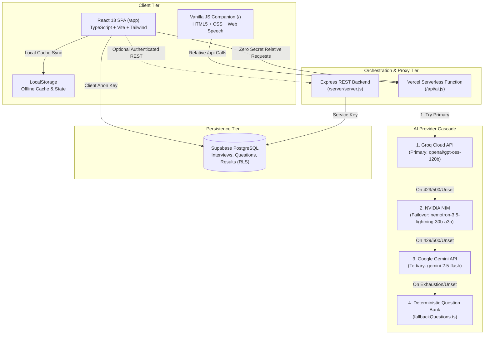

# PrepMind AI — System Architecture & Technical Specifications

This document outlines the architecture, data flow, provider cascade, security posture, and offline resilience mechanisms of the PrepMind AI platform.

---

## 1. High-Level Architecture Overview

PrepMind AI implements a dual-tier client architecture with a secure, zero-leakage proxy and multi-provider fallback cascade:

---

## 2. Core Architectural Principles

1. **Zero Client Secret Exposure**:
   - The browser client never has access to raw LLM API keys (`GROQ_API_KEY`, `NVIDIA_API_KEY`, `GEMINI_API_KEY`).
   - All AI requests route through `/api/ai`, which resolves as a relative path to the serverless function.
2. **Resilience & Zero User Lockout**:
   - When upstream API quotas are exhausted, credentials are missing, or network conditions drop, the app does not crash or present an error wall.
   - It seamlessly serves deterministic, syllabus-accurate practice questions from [`app/src/data/fallbackQuestions.ts`](../app/src/data/fallbackQuestions.ts) and logs progress to `localStorage`.
3. **Dual-Discovery Serverless Architecture**:
   - To accommodate Vercel configurations whether root directory is set to `.` (root) or `app/`, the serverless function is maintained identically at:
     - [`api/ai.js`](../api/ai.js) (Root discovery)
     - [`app/api/ai.js`](../app/api/ai.js) (`app/` root discovery)
   - Both files have identical SHA-256 signatures and validation logic.

---

## 3. Frontend Architecture (`/app`)

The primary production application is built on:
- **Framework**: React 18.3.1 with strict TypeScript 5.4.
- **Build Tooling**: Vite 5.2 with `@vitejs/plugin-react-swc` and PWA support via `vite-plugin-pwa`.
- **Styling**: Tailwind CSS 3.4 using the **Midnight / Terminal-Dark** design token palette.
- **State Management**:
  - `ExamContext`: Manages active exam selection (e.g. GATE CSE, CAT, UPSC), target syllabus paths, and difficulty level.
  - `AuthContext`: Manages user credentials with graceful guest-mode fallbacks.
  - `ThemeContext`: Provides dark/midnight theme toggling.
- **Routing**: `react-router-dom` v6 with client-side SPA routing:
  - `/` — Homepage, exam syllabus onboarding, and syllabus navigation.
  - `/practice` — Interactive MCQ drilling engine with solution explanations.
  - `/chat` — Socratic AI study tutor with rich Markdown rendering.
  - `/progress` — Performance analytics, question history, and drill stats.
  - `/profile` — User settings, guest mode status, and theme preferences.

---

## 4. Multi-Provider AI Cascade Order

Requests to `POST /api/ai` follow an automated failover sequence:

| Priority | Provider | Model | Typical Latency | Role |
| :---: | :--- | :--- | :---: | :--- |
| **1** | **Groq Cloud** | `openai/gpt-oss-120b` | ~300ms | Ultra-fast primary generation |
| **2** | **NVIDIA NIM** | `nvidia/nemotron-3.5-lightning-30b-a3b` | ~700ms | High-performance failover |
| **3** | **Google Gemini** | `gemini-2.5-flash` / `1.5-flash` | ~1.2s | Reliable tertiary reasoning fallback |
| **4** | **Offline Bank** | Built-in TypeScript dataset | ~0ms | Deterministic local fallback |

### Request Validation Order
To protect upstream quotas, `/api/ai` enforces strict order-of-operations:
1. Validates HTTP method (`GET` for health check, `POST` for AI actions).
2. Validates JSON payload format and presence of required fields (`action`, `topic`, `difficulty`, or `message`).
3. Rejects invalid requests immediately with `400 Bad Request` prior to evaluating API credentials.

---

## 5. Database Schema & Row-Level Security

The database layer runs on **PostgreSQL (Supabase)**. See [`supabase_schema.sql`](../supabase_schema.sql):

- **`interviews` Table**: Tracks user study sessions and target exam roles.
  - Columns: `id`, `title`, `role`, `user_id`, `created_at`.
- **`questions` Table**: Stores generated questions, candidate options (JSONB), answers, and explanations.
  - Columns: `id`, `interview_id`, `question`, `options`, `correct_answer`, `explanation`, `created_at`.
- **`results` Table**: Tracks answer submissions, scores, and completion timestamps.
  - Columns: `id`, `interview_id`, `score`, `total_questions`, `answers`, `created_at`.

### Security (RLS)
Idempotent Row-Level Security policies ensure:
- Unauthenticated guest users operate with offline local storage isolation.
- Authenticated users access only records linked to their `auth.uid()`.
